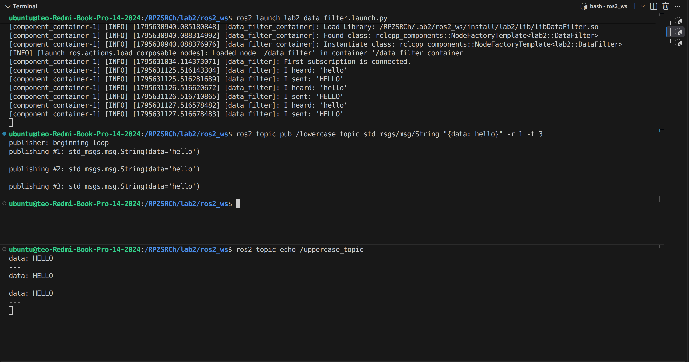
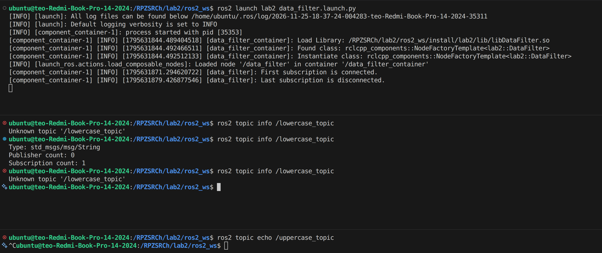
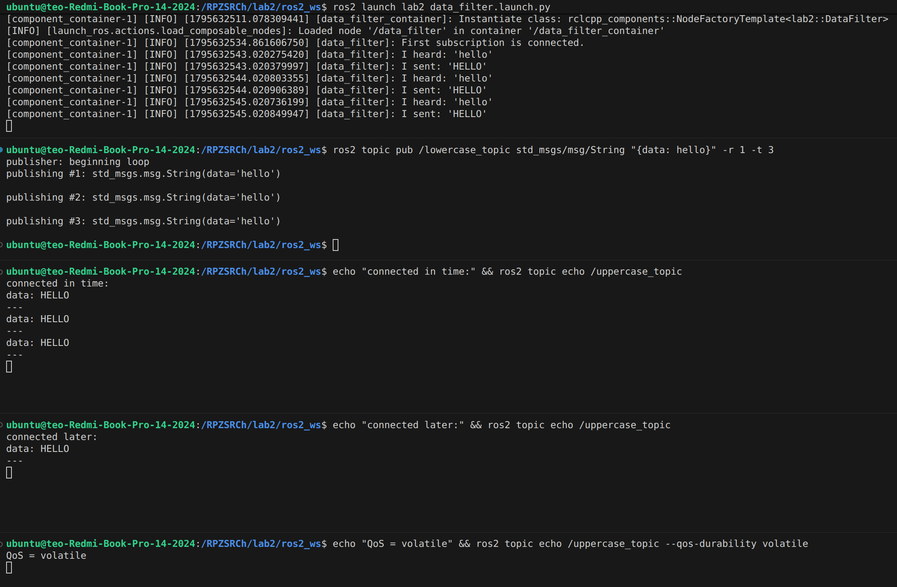
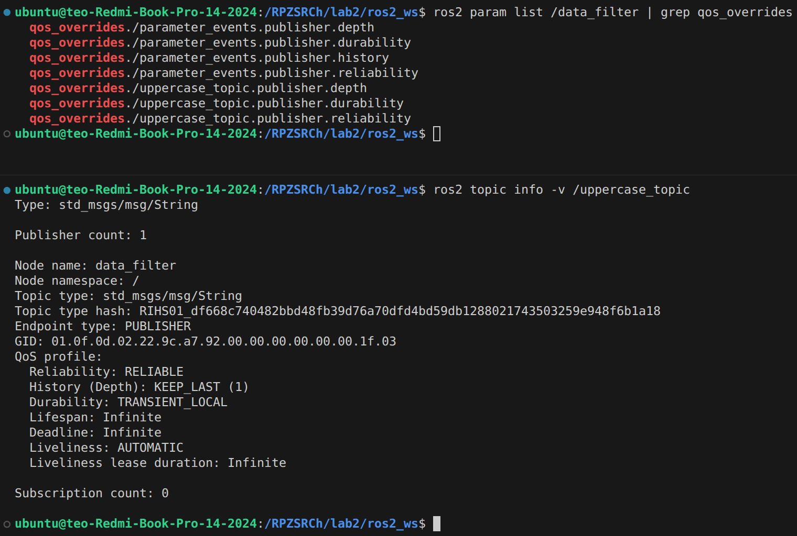
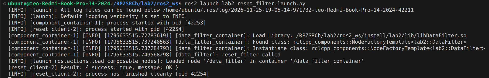
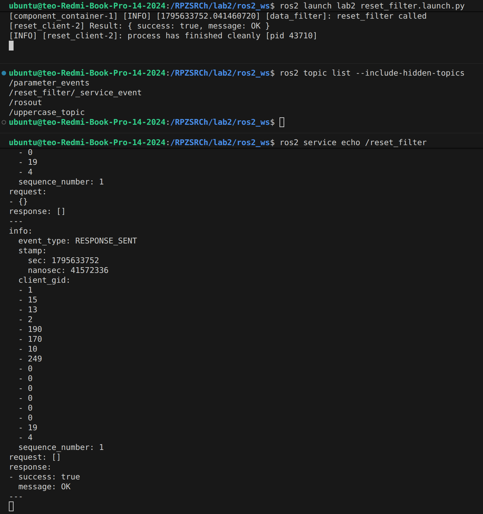
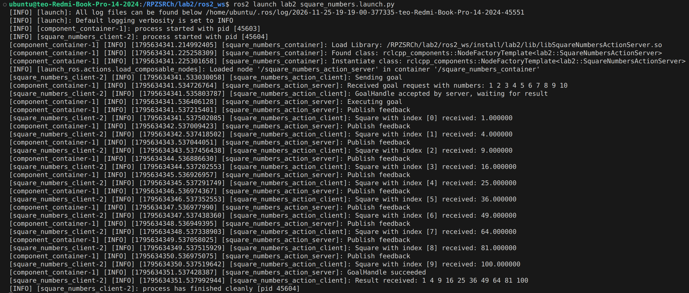
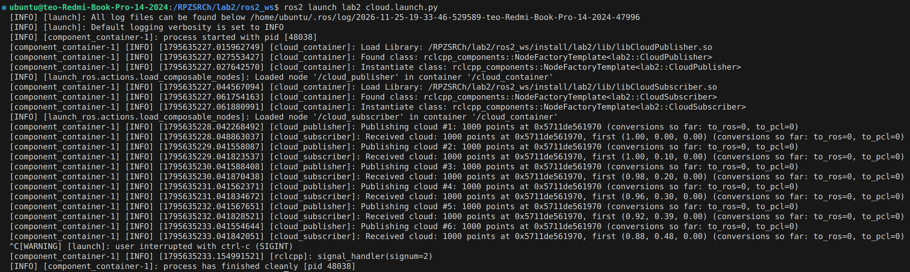
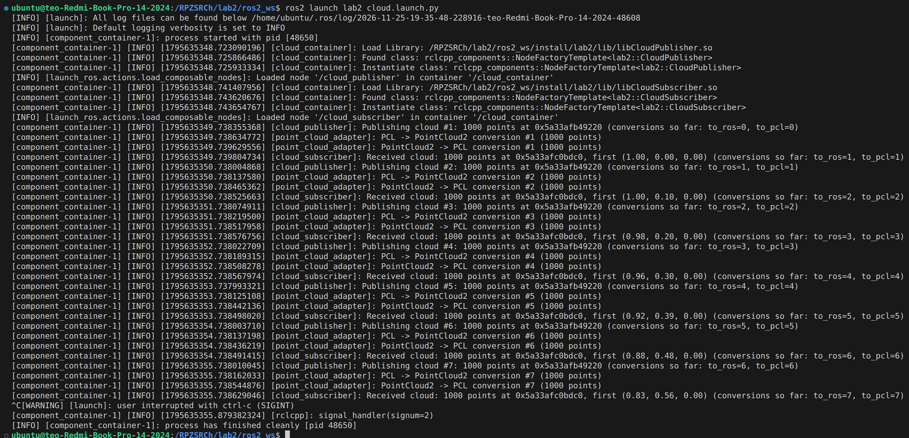

<p align="center"><b>МОНУ НТУУ КПІ ім. Ігоря Сікорського ФПСПМ СПіСКС</b></p>

<p align="center">
<b>Звіт з лабораторної роботи 2</b><br/>
"Інтерфейси"<br/>
дисципліни "Розробка ПЗ систем реального часу"
</p>

<p align="right"><b>Студент</b>: Козлов Сергій Олександрович група КВ-33</p>
<p align="right"><b>Рік</b>: 2026</p>

## Мета роботи
Навчитися проектувати топіки, асинхронні сервіси та дії (Actions) в ROS 2, конфігурувати сумісні політики QoS (Quality of Service), реалізовувати «ледачу» публікацію даних (Lazy Publishers) та оптимізувати обмін даними за допомогою механізму адаптації типів (TypeAdaptation).

## Виконання Роботи

### 2.1 Створення вузла обробки та фільтрації даних data_filter

#### 1. Написати C++ вузол data_filter, який підписується на вхідну тему з рядками std_msgs::msg::String, переводить текст у верхній регістр та публікує його у вихідну тему uppercase_topic.

Вузол `data_filter` (`DataFilter.cpp`) підписується на тему `lowercase_topic`, переводить кожен отриманий рядок у верхній регістр і публікує результат у `uppercase_topic`.

```bash
ros2 launch lab2 data_filter.launch.py
ros2 topic pub /lowercase_topic std_msgs/msg/String "{data: hello}" -r 1 -t 3
ros2 topic echo /uppercase_topic
```



#### 2. Реалізувати matched_callback для вихідного видавця: підписка на вхідні дані має створюватися лише тоді, коли з’являється хоча б один слухач на uppercase_topic, і вимикатися, коли кількість слухачів стає 0.

`matched_callback` задається в `PublisherOptions` вихідного видавця і викликається щоразу, коли змінюється кількість підписників на `uppercase_topic`. Коли з'являється перший підписник, вузол створює підписку на `lowercase_topic`; коли від'єднується останній, підписка знищується (`lowercase_sub = nullptr`).

```bash
ros2 launch lab2 data_filter.launch.py
ros2 topic info /lowercase_topic
ros2 topic echo /uppercase_topic
```



#### 3. Конфігурувати видавця з використанням QoS профілю transient_local глибиною 1 щоб передавати тільки останнє повідомлення.

Видавець створюється з профілем `rclcpp::QoS(1).transient_local()`. Видавець зберігає останнє повідомлення, і підписник, що під'єднався пізніше, одразу отримує його. Повідомлення зберігається, поки існує сам видавець.

```bash
ros2 launch lab2 data_filter.launch.py
ros2 topic pub /lowercase_topic std_msgs/msg/String "{data: hello}" -r 1 -t 3
echo "connected in time:" && ros2 topic echo /uppercase_topic
echo "connected later:" && ros2 topic echo /uppercase_topic
echo "QoS = volatile" && ros2 topic echo /uppercase_topic --qos-durability volatile
```



#### 4. Додати підтримку перевизначення політик Depth, Reliability, Durability за допомогою rclcpp::QosOverridingOptions.

`QosOverridingOptions` також задається в `PublisherOptions`. Для кожної з указаних політик rclcpp оголошує параметр виду `qos_overrides./uppercase_topic.publisher.<політика>`; його значення застосовується під час створення видавця. Значення можна задати в параметрах вузла у launch-файлі:

```python
parameters=[{
    'qos_overrides./uppercase_topic.publisher.depth': 1,
    'qos_overrides./uppercase_topic.publisher.reliability': 'reliable',
    'qos_overrides./uppercase_topic.publisher.durability': 'transient_local',
}],
```

Перевірка:

```bash
ros2 param list /data_filter | grep qos_overrides
ros2 topic info -v /uppercase_topic
```



#### 5. Реалізувати асинхронний сервіс та його інтроспекції: Додати до вузла сервісний сервер ResetFilter. Написати сервісний клієнт, що виконує асинхронний виклик async_send_request з обробкою таймауту очікування через future.wait_for(...). Ввімкнути інтроспекцію сервісу через configure_introspection (зі станом RCL_SERVICE_INTROSPECTION_CONTENTS) та перевірити перехоплення подій через CLI-команду з опцією "include_ hidden_topics".

Сервіс `reset_filter` (метод `create_reset_service` у `DataFilter.cpp`) має стандартний тип `std_srvs/srv/Trigger`.

Клієнт (`ResetFilterClient.cpp`) надсилає запит до сервісу в окремому потоці і чекає на відповідь через `future.wait_for(3s)`. Основний потік тим часом обробляє вузол через `exec.spin()`. Після отримання відповіді (чи таймауту) робочий потік викликає `rclcpp::shutdown()`, що зупиняє `spin()` і завершує клієнт.

```bash
ros2 launch lab2 reset_filter.launch.py
```



Інтроспекція публікує події сервісу у приховану тему `/reset_filter/_service_event`.

```bash
ros2 launch lab2 reset_filter.launch.py
ros2 topic list --include-hidden-topics
ros2 service echo /reset_filter
```



#### 6. Розробити Action-сервер, реалізувати асинхронне виконання обробки масиву даних у окремому потоці, публікацію періодичного фідбеку про поточний стан (чи досягнутий стан Succeded).

Інтерфейс дії (`SquareNumbers.action`) визначено в окремому пакеті `lab2_interfaces`.

Сервер (`SquareNumbersActionServer.cpp`) отримує масив чисел і підносить їх до квадрату по одному, публікуючи фідбек після кожного числа. Обробка цілі виконується в окремому потоці, щоб не блокувати виконавця.

Клієнт (`SquareNumbersActionClient.cpp`) відправляє запит на обробку цілі через 500ms від його створення і завершує свою роботу по отриманні остаточного результату. 

```bash
ros2 launch lab2 square_numbers.launch.py
```



#### 7*. Створити адаптер між типом sensor_msgs/msg/PointCloud2 і будь-яким на ваш вибір з бібліотеки PCL. Створити видавця та підписника використовуючи цей функціонал у різних компонентах, і переконайтеся, що перетворення даних не виконується, якщо ввімкнено внутрішньопроцесну взаємодію.

Адаптер (`point_cloud_adapter.hpp`) зв'язує `pcl::PointCloud<pcl::PointXYZ>` з `sensor_msgs::msg::PointCloud2` і веде глобальні лічильники перетворень.

Видавець (`CloudPublisher.cpp`) раз на секунду публікує хмару з 1000 точок як `std::unique_ptr<PointCloudXYZ>`.
Підписник (`CloudSubscriber.cpp`) приймає `std::unique_ptr<PointCloudXYZ>`.
Обидва виводять адресу об'єкта хмари.

```bash
ros2 launch lab2 cloud.launch.py
```

Коли обидва компоненти працюють в одному процесі з увімкненою внутрішньопроцесною взаємодією, підписник отримує той самий об'єкт, що створив видавець. Іншими словами, відбувається zero-copy передача даних між вузлами.



Якщо ж відключити внутрішньопроцесну взаємодію (`use_intra_process_comms: False` для обох компонентів у `cloud.launch.py`), кожна хмара перетворюється на `PointCloud2`, передається через DDS і в підписника перетворюється назад на `pcl::PointCloud`.



## Лістинг коду програми

### DataFilter.cpp

```cpp
// lab2/ros2_ws/src/lab2/src/DataFilter.cpp

#include <algorithm>
#include <cctype>
#include "rclcpp/rclcpp.hpp"
#include "rclcpp_components/register_node_macro.hpp"
#include "std_msgs/msg/string.hpp"
#include "std_srvs/srv/trigger.hpp"

namespace lab2
{

  class DataFilter : public rclcpp::Node
  {
  private:
    rclcpp::Subscription<std_msgs::msg::String>::SharedPtr lowercase_sub;
    rclcpp::Publisher<std_msgs::msg::String>::SharedPtr uppercase_pub;
    rclcpp::Service<std_srvs::srv::Trigger>::SharedPtr reset_srv;

  public:
    explicit DataFilter(const rclcpp::NodeOptions &options) : Node("data_filter", options)
    {
      create_reset_service();
      create_uppercase_publisher();
    }

  private:
    void create_reset_service() {
      reset_srv = create_service<std_srvs::srv::Trigger>(
        "reset_filter",
        [this](
          const std::shared_ptr<std_srvs::srv::Trigger::Request> _,
          const std::shared_ptr<std_srvs::srv::Trigger::Response> res
        ) {
          RCLCPP_INFO(this->get_logger(), "reset_filter called");

          res->success = true;
          res->message = "OK";
        }
      );

      reset_srv->configure_introspection(
        get_clock(),
        rclcpp::SystemDefaultsQoS(),
        RCL_SERVICE_INTROSPECTION_CONTENTS
      );
    }

    void create_uppercase_publisher() {
      rclcpp::PublisherOptions pub_options;

      pub_options.event_callbacks.matched_callback =
      [this](rclcpp::MatchedInfo& s) {
        if (lowercase_sub) {
          if (s.current_count == 0) {
            RCLCPP_INFO(this->get_logger(), "Last subscription is disconnected.");

            unsubscribe_from_lowercase_topic();
          }
        } else {
          if (s.current_count != 0) {
            RCLCPP_INFO(this->get_logger(), "First subscription is connected.");

            subscribe_to_lowercase_topic();
          }
        }
      };

      pub_options.qos_overriding_options = rclcpp::QosOverridingOptions{
        rclcpp::QosPolicyKind::Depth,
        rclcpp::QosPolicyKind::Reliability,
        rclcpp::QosPolicyKind::Durability,
      };

      uppercase_pub = this->create_publisher<std_msgs::msg::String>("uppercase_topic", rclcpp::QoS(1).transient_local(), pub_options);
    }

    void subscribe_to_lowercase_topic() {
      lowercase_sub = this->create_subscription<std_msgs::msg::String>(
        "lowercase_topic",
        10,
        [this](const std_msgs::msg::String& input) {
          RCLCPP_INFO(this->get_logger(), "I heard: '%s'", input.data.c_str());

          auto output = std_msgs::msg::String();
          output.data = std::string(input.data.size(), '\0');

          std::transform(
            input.data.begin(),
            input.data.end(),
            output.data.begin(),
            [](unsigned char c){ return std::toupper(c); }
          );

          RCLCPP_INFO(this->get_logger(), "I sent: '%s'", output.data.c_str());

          uppercase_pub->publish(output);
        }
      );
    }
  
    void unsubscribe_from_lowercase_topic() {
      lowercase_sub = nullptr;
    }
  };

} // namespace lab2

RCLCPP_COMPONENTS_REGISTER_NODE(lab2::DataFilter)
```

### ResetFilterClient.cpp

```cpp
// lab2/ros2_ws/src/lab2/src/ResetFilterClient.cpp

#include <chrono>
#include <cstdio>
#include <future>
#include <thread>

#include "rclcpp/rclcpp.hpp"
#include "std_srvs/srv/trigger.hpp"

using namespace std::chrono_literals;

int main(int argc, char** argv) {
    rclcpp::init(argc, argv);

    auto node = std::make_shared<rclcpp::Node>("reset_client");
    auto client = node->create_client<std_srvs::srv::Trigger>("reset_filter");

    rclcpp::executors::SingleThreadedExecutor exec;
    exec.add_node(node);

    std::thread worker([&] {
        try {
            if (client->wait_for_service(2s)) {
                auto future = client->async_send_request(std::make_shared<std_srvs::srv::Trigger::Request>());
                
                if (future.wait_for(3s) == std::future_status::ready) {
                    auto res = future.get();

                    printf(
                        "Result: { success: %s, message: %s }\n",
                        res->success ? "true" : "false",
                        res->message.c_str()
                    );
                } else {
                    client->remove_pending_request(future);
                    
                    printf("Result: timeout\n");
                }
            } else {
                printf("Service not available!\n");
            }
        } catch (const std::exception& e) {
            fprintf(stderr, "Error: %s\n", e.what());
        }

        rclcpp::shutdown();
    });

    exec.spin();
    worker.join();

    return 0;
}
```

### SquareNumbers.action

```text
# lab2/ros2_ws/src/lab2_interfaces/action/SquareNumbers.action

# Goal
float64[] numbers
---
# Result
float64[] squares
---
# Feedback
uint32 index          # position of the number just processed
float64 square        # its square
```

### SquareNumbersActionServer.cpp

```cpp
// lab2/ros2_ws/src/lab2/src/SquareNumbersActionServer.cpp

#include <memory>
#include <sstream>
#include <thread>
#include <vector>

#include "lab2_interfaces/action/square_numbers.hpp"
#include "rclcpp/rclcpp.hpp"
#include "rclcpp_action/rclcpp_action.hpp"
#include "rclcpp_components/register_node_macro.hpp"

namespace lab2
{
class SquareNumbersActionServer : public rclcpp::Node
{
public:
  using Action = lab2_interfaces::action::SquareNumbers;
  using GoalHandle = rclcpp_action::ServerGoalHandle<Action>;

private:
  rclcpp_action::Server<Action>::SharedPtr server;

public:
  explicit SquareNumbersActionServer(const rclcpp::NodeOptions& options = rclcpp::NodeOptions())
  : Node("square_numbers_action_server", options)
  {

    auto handle_goal = [this] (
      const rclcpp_action::GoalUUID& uuid,
      std::shared_ptr<const Action::Goal> goal
    ) {
        (void)uuid;

        std::stringstream ss;

        ss << "Received goal request with numbers: ";
        for (auto number : goal->numbers) {
          ss << number << " ";
        }

        RCLCPP_INFO(this->get_logger(), "%s", ss.str().c_str());

        // Reject long goals, to make API more anoying
        if (goal->numbers.size() > 10) {
            return rclcpp_action::GoalResponse::REJECT;
        }

        return rclcpp_action::GoalResponse::ACCEPT_AND_EXECUTE;
    };

    auto handle_cancel = [this] (
      const std::shared_ptr<GoalHandle> goal_handle
    ) {
        (void)goal_handle;

        RCLCPP_INFO(this->get_logger(), "Received request to cancel goal");

        return rclcpp_action::CancelResponse::ACCEPT;
    };

    auto handle_accepted = [this] (
      const std::shared_ptr<GoalHandle> goal_handle
    ) {
        auto execute_in_thread = [this, goal_handle]() { return this->execute(goal_handle); };

        std::thread{execute_in_thread}.detach();
    };

    this->server = rclcpp_action::create_server<Action>(
      this,
      "square_numbers",
      handle_goal,
      handle_cancel,
      handle_accepted
    );
  }

private: 
  void execute(const std::shared_ptr<GoalHandle> goal_handle)
  {
    RCLCPP_INFO(this->get_logger(), "Executing goal");

    rclcpp::Rate loop_rate(1);

    const auto goal = goal_handle->get_goal();
    const auto& numbers = goal->numbers;

    auto feedback = std::make_shared<Action::Feedback>();

    std::vector<double> squares;

    auto result = std::make_shared<Action::Result>();

    for (int i = 0; (i < numbers.size()) && rclcpp::ok(); ++i) {
      if (goal_handle->is_canceling()) {
        result->squares = squares;
        goal_handle->canceled(result);

        RCLCPP_INFO(this->get_logger(), "GoalHandle canceled");
        return;
      }

      auto square = numbers[i] * numbers[i];
      squares.push_back(square);

      feedback->index = i;
      feedback->square = square;
      goal_handle->publish_feedback(feedback);
      RCLCPP_INFO(this->get_logger(), "Publish feedback");

      loop_rate.sleep();
    }

    if (rclcpp::ok()) {
      result->squares = squares;
      goal_handle->succeed(result);

      RCLCPP_INFO(this->get_logger(), "GoalHandle succeeded");
    }
  }
};  // class SquareNumbersActionServer

}  // namespace lab2

RCLCPP_COMPONENTS_REGISTER_NODE(lab2::SquareNumbersActionServer)
```

### SquareNumbersActionClient.cpp

```cpp
// lab2/ros2_ws/src/lab2/src/SquareNumbersActionClient.cpp

#include <chrono>
#include <memory>
#include <sstream>

#include "lab2_interfaces/action/square_numbers.hpp"
#include "rclcpp/rclcpp.hpp"
#include "rclcpp_action/rclcpp_action.hpp"
#include "rclcpp_components/register_node_macro.hpp"

namespace lab2
{
using namespace std::chrono_literals;

class SquareNumbersActionClient : public rclcpp::Node
{
public:
  using Action = lab2_interfaces::action::SquareNumbers;
  using GoalHandle = rclcpp_action::ClientGoalHandle<Action>;

private:
  rclcpp_action::Client<Action>::SharedPtr client;
  rclcpp::TimerBase::SharedPtr timer;

public:
  explicit SquareNumbersActionClient(const rclcpp::NodeOptions& node_options = rclcpp::NodeOptions())
    : Node("square_numbers_action_client", node_options)
  {
    this->client = rclcpp_action::create_client<Action>(
      this->get_node_base_interface(),
      this->get_node_graph_interface(),
      this->get_node_logging_interface(),
      this->get_node_waitables_interface(),
      "square_numbers"
    );

    this->timer = this->create_wall_timer(
      500ms,
      [this]() { return this->send_goal(); }
    );
  }

  void send_goal()
  {

    this->timer->cancel();

    if (!this->client->wait_for_action_server(10s)) {
      RCLCPP_ERROR(this->get_logger(), "Action server not available after waiting");

      rclcpp::shutdown();
      return;
    }

    auto goal_msg = Action::Goal();
    goal_msg.numbers = { 1, 2, 3, 4, 5, 6, 7, 8, 9, 10 };

    RCLCPP_INFO(this->get_logger(), "Sending goal");

    auto send_goal_options = rclcpp_action::Client<Action>::SendGoalOptions();
    send_goal_options.goal_response_callback = [this] (
      const GoalHandle::SharedPtr& goal_handle)
      {
        if (!goal_handle) {
          RCLCPP_ERROR(this->get_logger(), "GoalHandle was rejected by server");
        } else {
          RCLCPP_INFO(this->get_logger(), "GoalHandle accepted by server, waiting for result");
        }
      };

    send_goal_options.feedback_callback = [this](
      GoalHandle::SharedPtr,
      const std::shared_ptr<const Action::Feedback> feedback)
      {
        RCLCPP_INFO(
          this->get_logger(),
          "Square with index [%d] received: %f",
          feedback->index,
          feedback->square
        );
      };

    send_goal_options.result_callback = [this](
      const GoalHandle::WrappedResult& result)
      {
        switch (result.code) {
          case rclcpp_action::ResultCode::SUCCEEDED:
            break;
          case rclcpp_action::ResultCode::ABORTED:
            RCLCPP_ERROR(this->get_logger(), "GoalHandle was aborted");
            return;
          case rclcpp_action::ResultCode::CANCELED:
            RCLCPP_ERROR(this->get_logger(), "GoalHandle was canceled");
            return;
          default:
            RCLCPP_ERROR(this->get_logger(), "Unknown result code");
            return;
        }

        std::stringstream ss;
        ss << "Result received: ";
        for (auto number : result.result->squares) {
          ss << number << " ";
        }

        RCLCPP_INFO(this->get_logger(), "%s", ss.str().c_str());
        rclcpp::shutdown();
      };

    this->client->async_send_goal(goal_msg, send_goal_options);
  }
};  // class SquareNumbersActionClient

}  // namespace lab2

RCLCPP_COMPONENTS_REGISTER_NODE(lab2::SquareNumbersActionClient)
```

### point_cloud_adapter.hpp

```cpp
// lab2/ros2_ws/src/lab2/include/lab2/point_cloud_adapter.hpp

#pragma once

#include <atomic>
#include <bit>
#include <cstddef>
#include <cstdint>
#include <cstring>
#include <stdexcept>
#include <string>

#include <pcl/point_cloud.h>
#include <pcl/point_types.h>

#include "rclcpp/logging.hpp"
#include "rclcpp/type_adapter.hpp"
#include "sensor_msgs/msg/point_cloud2.hpp"
#include "sensor_msgs/msg/point_field.hpp"

namespace lab2
{

using PointCloudXYZ = pcl::PointCloud<pcl::PointXYZ>;

inline std::atomic<std::size_t> to_ros_conversions{0};
inline std::atomic<std::size_t> to_pcl_conversions{0};

}  // namespace lab2

template<>
struct rclcpp::TypeAdapter<lab2::PointCloudXYZ, sensor_msgs::msg::PointCloud2>
{
  using is_specialized = std::true_type;
  using custom_type = lab2::PointCloudXYZ;
  using ros_message_type = sensor_msgs::msg::PointCloud2;

  // PCL -> ROS: pack x, y, z of every point as three float32 (12 bytes per point).
  static void convert_to_ros_message(const custom_type& source, ros_message_type& destination)
  {
    const auto count = ++lab2::to_ros_conversions;
    RCLCPP_INFO(
      rclcpp::get_logger("point_cloud_adapter"),
      "PCL -> PointCloud2 conversion #%zu (%zu points)", count, source.size());

    // PCL stamps are microseconds; ROS uses seconds + nanoseconds.
    destination.header.frame_id = source.header.frame_id;
    destination.header.stamp.sec = static_cast<int32_t>(source.header.stamp / 1'000'000);
    destination.header.stamp.nanosec = static_cast<uint32_t>((source.header.stamp % 1'000'000) * 1'000);

    // Trust width x height only if it matches the number of points; otherwise
    // describe the cloud as unordered (one row).
    const bool organized = static_cast<std::size_t>(source.width) * source.height == source.size();
    destination.width = organized ? source.width : static_cast<uint32_t>(source.size());
    destination.height = organized ? source.height : 1;

    destination.fields.resize(3);
    const char* names[] = {"x", "y", "z"};
    for (uint32_t i = 0; i < 3; ++i) {
      destination.fields[i].name = names[i];
      destination.fields[i].offset = i * sizeof(float);
      destination.fields[i].datatype = sensor_msgs::msg::PointField::FLOAT32;
      destination.fields[i].count = 1;
    }

    destination.is_bigendian = (std::endian::native == std::endian::big);
    destination.point_step = 3 * sizeof(float);
    destination.row_step = destination.point_step * destination.width;
    destination.is_dense = source.is_dense;

    destination.data.resize(static_cast<std::size_t>(destination.row_step) * destination.height);
    auto* out = destination.data.data();
    for (const auto& p : source.points) {
      const float xyz[3] = {p.x, p.y, p.z};
      std::memcpy(out, xyz, sizeof(xyz));
      out += destination.point_step;
    }
  }

  // ROS -> PCL: find the x, y, z fields and read them from every point.
  static void convert_to_custom(const ros_message_type & source, custom_type & destination)
  {
    const auto count = ++lab2::to_pcl_conversions;
    RCLCPP_INFO(
      rclcpp::get_logger("point_cloud_adapter"),
      "PointCloud2 -> PCL conversion #%zu (%u points)", count, source.width * source.height);

    if (source.is_bigendian != (std::endian::native == std::endian::big)) {
      throw std::runtime_error("PointCloud2 byte order differs from this machine's");
    }

    // Offsets of x, y, z inside one point. Other fields (intensity, rgb...) are ignored.
    uint32_t offsets[3];
    const char* names[] = {"x", "y", "z"};
    for (int i = 0; i < 3; ++i) {
      bool found = false;

      for (const auto& field : source.fields) {
        if (field.name == names[i]) {
          if (field.datatype != sensor_msgs::msg::PointField::FLOAT32) {
            throw std::runtime_error(std::string("PointCloud2 field '") + names[i] + "' is not float32");
          }

          offsets[i] = field.offset;
          found = true;

          break;
        }
      }

      if (!found) {
        throw std::runtime_error(std::string("PointCloud2 has no '") + names[i] + "' field");
      }
    }

    const std::size_t needed = static_cast<std::size_t>(source.row_step) * source.height;
    if (source.data.size() < needed) {
      throw std::runtime_error("PointCloud2 data is shorter than row_step * height");
    }

    destination.header.frame_id = source.header.frame_id;
    destination.header.stamp =
      static_cast<uint64_t>(source.header.stamp.sec) * 1'000'000 + source.header.stamp.nanosec / 1'000;
    destination.width = source.width;
    destination.height = source.height;
    destination.is_dense = source.is_dense;
    destination.points.resize(static_cast<std::size_t>(source.width) * source.height);

    std::size_t i = 0;
    for (uint32_t row = 0; row < source.height; ++row) {
      const uint8_t* point = source.data.data() + static_cast<std::size_t>(row) * source.row_step;

      for (uint32_t col = 0; col < source.width; ++col, point += source.point_step) {
        auto& p = destination.points[i++];
        std::memcpy(&p.x, point + offsets[0], sizeof(float));
        std::memcpy(&p.y, point + offsets[1], sizeof(float));
        std::memcpy(&p.z, point + offsets[2], sizeof(float));
      }
    }
  }
};

namespace lab2
{

using AdaptedPointCloud = rclcpp::TypeAdapter<PointCloudXYZ, sensor_msgs::msg::PointCloud2>;

}  // namespace lab2
```

### CloudPublisher.cpp

```cpp
// lab2/ros2_ws/src/lab2/src/CloudPublisher.cpp

#include <chrono>
#include <cmath>
#include <memory>

#include "lab2/point_cloud_adapter.hpp"
#include "rclcpp/rclcpp.hpp"
#include "rclcpp_components/register_node_macro.hpp"

namespace lab2
{
using namespace std::chrono_literals;

class CloudPublisher : public rclcpp::Node
{
private:
  rclcpp::Publisher<AdaptedPointCloud>::SharedPtr pub;
  rclcpp::TimerBase::SharedPtr timer;
  std::size_t count = 0;

public:
  explicit CloudPublisher(const rclcpp::NodeOptions& options)
  : Node("cloud_publisher", options)
  {
    pub = create_publisher<AdaptedPointCloud>("cloud", 10);

    timer = create_wall_timer(1s, [this]() { publish_cloud(); });
  }

private:
  void publish_cloud()
  {
    constexpr std::size_t points = 1000;
    const float phase = static_cast<float>(count) * 0.1f;

    auto cloud = std::make_unique<PointCloudXYZ>();
    cloud->header.frame_id = "map";
    cloud->header.stamp = static_cast<uint64_t>(now().nanoseconds() / 1'000);  // PCL uses microseconds
    cloud->reserve(points);

    for (std::size_t i = 0; i < points; ++i) {
      const float t = static_cast<float>(i) * 0.05f;
      cloud->push_back({std::cos(t + phase), std::sin(t + phase), t * 0.1f});
    }

    RCLCPP_INFO(
      get_logger(), "Publishing cloud #%zu: %zu points at %p (conversions so far: to_ros=%zu, to_pcl=%zu)",
      ++count, cloud->size(), static_cast<void*>(cloud.get()),
      to_ros_conversions.load(), to_pcl_conversions.load());

    // Handing over the unique_ptr lets intra-process delivery move the object
    // to a subscriber instead of copying or converting it.
    pub->publish(std::move(cloud));
  }
};

}  // namespace lab2

RCLCPP_COMPONENTS_REGISTER_NODE(lab2::CloudPublisher)
```

### CloudSubscriber.cpp

```cpp
// lab2/ros2_ws/src/lab2/src/CloudSubscriber.cpp

#include <memory>

#include "lab2/point_cloud_adapter.hpp"
#include "rclcpp/rclcpp.hpp"
#include "rclcpp_components/register_node_macro.hpp"

namespace lab2
{

class CloudSubscriber : public rclcpp::Node
{
private:
  rclcpp::Subscription<AdaptedPointCloud>::SharedPtr sub;

public:
  explicit CloudSubscriber(const rclcpp::NodeOptions& options)
  : Node("cloud_subscriber", options)
  {
    sub = create_subscription<AdaptedPointCloud>(
      "cloud",
      10,
      [this](std::unique_ptr<PointCloudXYZ> cloud) {
        const auto& first = cloud->front();

        RCLCPP_INFO(
          get_logger(), "Received cloud: %zu points at %p, first (%.2f, %.2f, %.2f) "
          "(conversions so far: to_ros=%zu, to_pcl=%zu)",
          cloud->size(), static_cast<void*>(cloud.get()), first.x, first.y, first.z,
          to_ros_conversions.load(), to_pcl_conversions.load());
      }
    );
  }
};

}  // namespace lab2

RCLCPP_COMPONENTS_REGISTER_NODE(lab2::CloudSubscriber)
```

## Висновки

В рамках лабораторної роботи було виконано ознайомлення з документацією та набуто навички з проектування тем (Topics), сервісів (Services) та дій (Actions) в ROS 2.

Було розроблено вузол обробки даних `data_filter` з «ледачею» публікацією даних (Lazy Publishing). Для цього вузла також були досліджені та налаштовані політики якості обслуговування (QoS) та засоби інтроспекції. Також було розроблено сервіс `reset_filter` для ознайомлення з можливостями сервісів. Було створено дію `square_numbers` з асинхронною обробкою даних і системою зворотного зв'язку. За допомогою механізму адаптації типів та внутрішньопроцесної взаємодії вдалося оптимізувати обмін даними між вузлами одного процесу і дослідити позапроцесну взаємодію.
